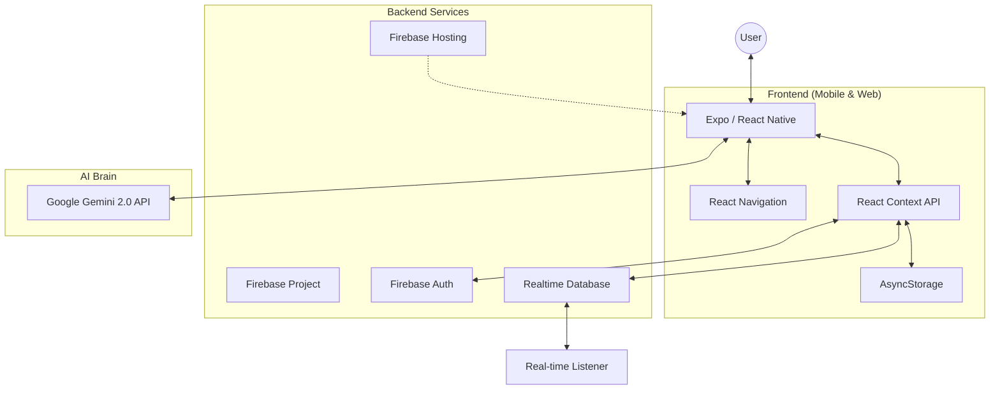
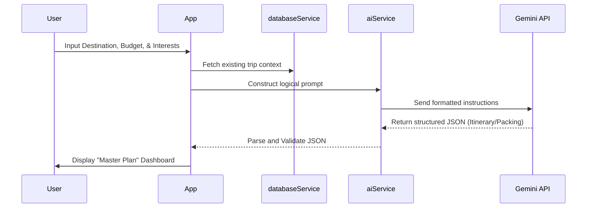

<p align="center">
  
</p>

<h1 align="center">🗺️ TravelWitch</h1>

<p align="center">
  <strong>Your Premium AI-Powered Travel Companion & Collaborative Budget Tracker</strong>
</p>

<p align="center">
  
  
  
  
  
</p>

<p align="center">
  <a href="https://routemate-6a885.web.app/">(🌐 Live Demo)</a> •
  <a href="#-features">Features</a> •
  <a href="#-tech-stack">Tech Stack</a> •
  <a href="#-architecture">Architecture</a> •
  <a href="#-getting-started">Getting Started</a> •
  <a href="CONTRIBUTING.md">Contributing</a>
</p>

---

## 📖 About

**TravelWitch** is a "billionaire-level" travel management application designed to make trip planning precise, collaborative, and intelligent. Built for the modern traveler, it combines the power of **Google Gemini 2.0 AI** with seamless real-time synchronization to ensure every detail of your journey is perfectly orchestrated.

Whether you're planning a solo backpacking trip through Europe, a luxury family getaway, or a budget-conscious road trip with friends, TravelWitch handles the complexity so you can focus on the adventure.

---

## ✨ Features

### 🤖 AI-Powered "Master Plan"
*   **Intelligent Itineraries**: Generate logical, day-by-day travel plans based on your pace, budget, and interests using Gemini 2.0 Flash.
*   **Smart Packing**: Get categorized packing lists tailored to your destination's climate and trip type.
*   **Local Food Guide**: Discover must-try dishes and restaurants (with Veg/Non-Veg filtering) for every stop on your route.
*   **Budget Analysis**: AI-driven feasibility checks to ensure your dream trip matches your wallet.

### 👥 Real-Time Collaboration
*   **Share & Join**: Invite friends using 6-character unique codes.
*   **Live Sync**: Every expense, checklist item, and itinerary change is synced instantly across all devices.
*   **Multi-User Expenses**: Split costs equally or with custom amounts among travel companions.

### 💰 Comprehensive Financials
*   **Budgeting**: Set total trip budgets and track spending by category (Accommodation, Food, Transport, etc.).
*   **Multi-Currency Support**: Native support for INR, USD, EUR, GBP, and more.
*   **Visual Analytics**: Beautiful graphs and status bars showing your remaining funds.

### 🎒 Essential Utilities
*   **Checklist System**: Manage packing lists, essential documents, and even a food checklist.
*   **Timeline View**: A chronological view of your activities.
*   **Offline First**: Core features work without internet, syncing as soon as you're back online.

---

## 🏗️ Architecture

### High-Level System Overview



### Data Flow & Real-time Sync

TravelWitch uses a **Single Source of Truth** pattern via Firebase Realtime Database.

1.  **State Management**: React Context (`TravelContext`, `AuthContext`) manages global state.
2.  **Service Layer**: `databaseService.js` handles CRUD operations and initiates `onValue` listeners.
3.  **Synchronization**: When a user adds an expense or updates an itinerary item:
    *   The change is pushed to a shared Firebase node.
    *   All participants' apps receive a real-time event.
    *   Context updates automatically, triggering a UI re-render for everyone.

### AI Integration Flow



---

## 🛠️ Tech Stack

| Component | Technology | Purpose |
| :--- | :--- | :--- |
| **Framework** | [React Native](https://reactnative.dev/) / [Expo](https://expo.dev/) | Cross-platform (iOS, Android, Web) development |
| **Language** | JavaScript (ES6+) | Application logic |
| **Database** | [Firebase Realtime Database](https://firebase.google.com/docs/database) | Persistent data and real-time syncing |
| **Auth** | [Firebase Auth](https://firebase.google.com/docs/auth) | Google & Email/Password authentication |
| **AI Engine** | [Google Gemini 2.0 Flash](https://ai.google.dev/) | Itinerary and recommendation generation |
| **State** | React Context API | Global state and provider pattern |
| **Styling** | Vanilla CSS / StyleSheet | Custom theme system with Dark/Light support |
| **Monetization**| [RevenueCat](https://www.revenuecat.com/) | Premium subscriptions and purchase tracking |

---

## 🚀 Getting Started

### Prerequisites
*   [Node.js](https://nodejs.org/) (v18+)
*   [Expo Go](https://expo.dev/client) app on your mobile device (to test native features)
*   A Firebase project project with Realtime Database and Auth enabled.
*   A Google AI (Gemini) API Key.

### Quick Setup

1.  **Clone the Repo**:
    ```bash
    git clone https://github.com/praneeth132006/TravelWitch.git
    cd TravelWitch
    ```

2.  **Install Dependencies**:
    ```bash
    npm install
    ```

3.  **Environment Configuration**:
    Create a `.env` file in the root directory:
    ```env
    EXPO_PUBLIC_GEMINI_API_KEY=your_gemini_key
    EXPO_PUBLIC_FIREBASE_API_KEY=your_firebase_key
    # ... add other firebase config values
    ```

4.  **Run the App**:
    ```bash
    # For Web (PWA)
    npm run web

    # For Native (requires physical device or simulator)
    npx expo start
    ```

---

## 🤝 Contributing

We love contributions! Whether it's fixing a bug, adding a feature, or improving documentation.

1.  Read our [Contributing Guidelines](CONTRIBUTING.md).
2.  Fork the repo and create your branch.
3.  Submit a Pull Request for review.

---

## 📄 License

This project is private and proprietary. Copyright © 2024 Praneeth. All rights reserved.

---

<p align="center">
  Built with ✨ by <a href="https://github.com/praneeth132006">Praneeth</a>
</p>
