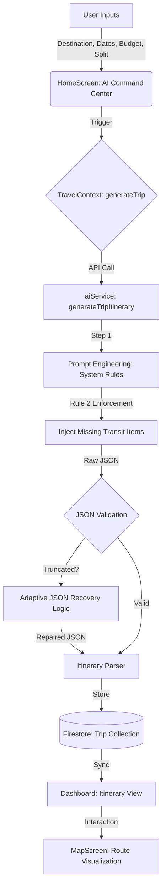
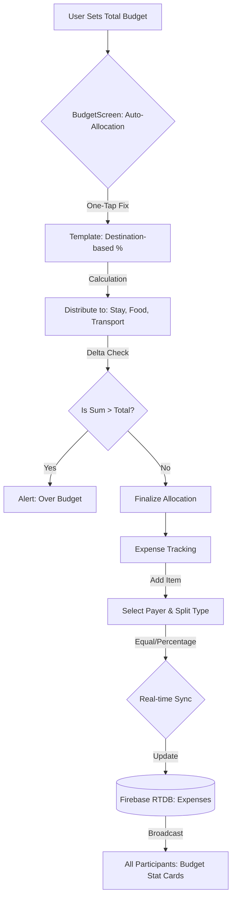
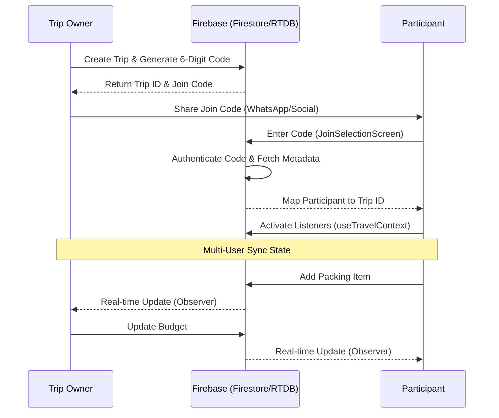
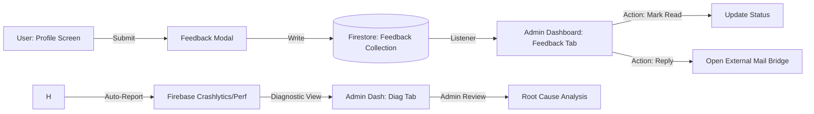
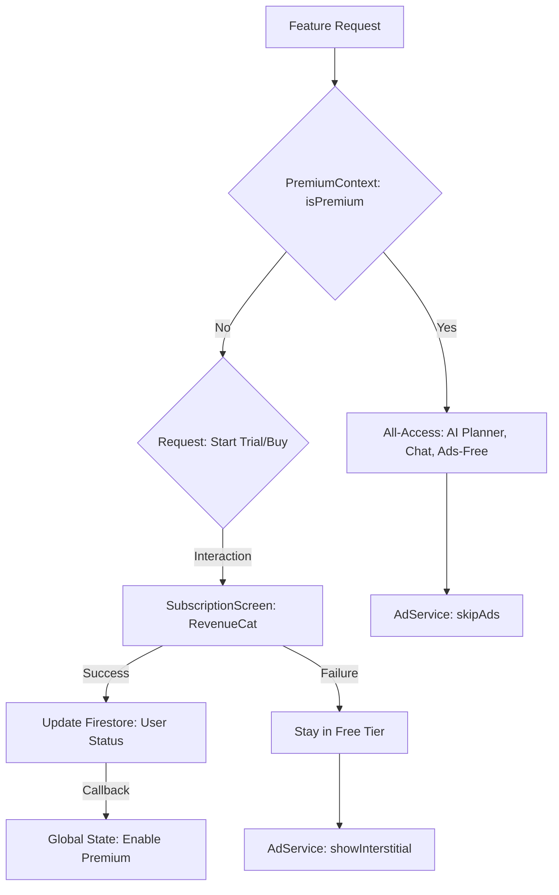
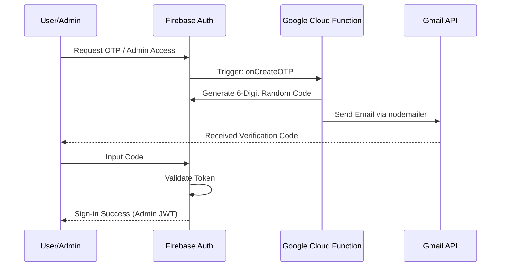
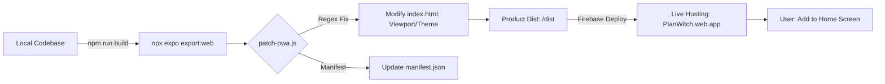

# PlanWitch Core Workflow Diagrams

This document provides high-detail technical and process diagrams for the core features of the PlanWitch application.

---

## 1. AI Trip Planning Lifecycle
This workflow describes the journey from user input to a fully realized, geographically optimized itinerary.

---

## 2. Automated Budgeting & Expense Engine
This workflow covers how PlanWitch manages finances, from initial planning to real-time expense tracking.

---

## 3. Real-time Multi-User Collaboration
How users join trips and stay synchronized across devices.

---

## 4. Admin & System Health Workflow
The flow of feedback and diagnostic data to the Admin Dashboard.

---

## 5. Subscription & Premium Feature Gateway
The logic governing access to AI-enabled features and RevenueCat integration.

---

## 6. Secure OTP Authentication Flow
Workflow for two-factor authentication and SaaS admin access.

---

## 7. PWA Deployment & Maintenance Pipeline
How local changes are built, patched for PWA compatibility, and deployed.

