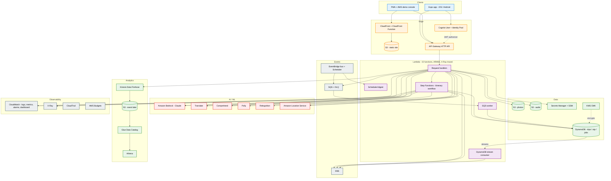

# PlanWitch on AWS

A complete AWS reference architecture for the PlanWitch travel app: **31 AWS services
in one CloudFormation stack**, deployed with AWS CDK, built for a project review and
designed to be deleted cleanly afterwards.

Nothing in the existing app is rewired. The Firebase backend keeps running exactly as
it does today; this is a parallel implementation plus a live console that demonstrates it.

---

## 1. Architecture



### Why it is shaped this way

| Decision | Reason |
| --- | --- |
| No VPC, no NAT gateway | A NAT gateway alone is ~$32/month. Nothing here needs private networking. |
| Two itinerary paths | API Gateway hard-caps a request at 30s. The synchronous route covers the common case; Step Functions handles anything slower. |
| DynamoDB on-demand | No idle cost, and the access pattern is a simple `userId` + `tripId` lookup. |
| ARM64 Lambda | ~20% cheaper per ms than x86 at identical performance. |
| SSM Parameter Store + Secrets Manager | Standard SSM parameters are free; the secret holds the genuinely sensitive third-party keys. |
| Presigned S3 uploads | Photos go browser → S3 directly, so no image bytes pass through Lambda. |

---

## 2. The 31 services

`GET /health` returns this list live from the deployed stack.

| # | Service | Role in PlanWitch |
| --- | --- | --- |
| 1 | CloudFormation | Every resource, via AWS CDK |
| 2 | IAM | 23 roles, scoped per function |
| 3 | KMS | Customer-managed key encrypting DynamoDB |
| 4 | Lambda | 15 functions (ARM64, Node 20) |
| 5 | API Gateway | HTTP API, 17 routes, CORS, access logs |
| 6 | DynamoDB | Trips, OTP (TTL), jobs (TTL) + a GSI |
| 7 | DynamoDB Streams | Fires on every trip write |
| 8 | S3 | 5 buckets: web, uploads, media, event lake, CloudTrail |
| 9 | CloudFront | HTTPS delivery of the PWA + console, OAC-locked origin |
| 10 | CloudFront Functions | Rewrites directory URLs at the edge |
| 11 | Cognito | User pool (sign-up/sign-in) + identity pool (guest map access) |
| 12 | Amazon Bedrock | Itinerary generation (Claude) |
| 13 | Amazon Translate | Itineraries in Hindi, Tamil, Telugu, French, Japanese |
| 14 | Amazon Comprehend | Language detection, sentiment, key phrases |
| 15 | Amazon Polly | Neural audio travel guide (Indian English voices) |
| 16 | Amazon Rekognition | Trip-photo labels, moderation, OCR |
| 17 | Amazon Location Service | Map tiles, place search, geocoding, routing |
| 18 | SES v2 | OTP email delivery |
| 19 | SNS | Trip + itinerary notifications, alarm destination |
| 20 | SQS | Async job queue with a dead-letter queue |
| 21 | Step Functions | draft → enrich → persist → notify workflow |
| 22 | EventBridge | Custom bus + rule routing app events to SQS |
| 23 | EventBridge Scheduler | Daily traveller digest, 09:00 IST |
| 24 | SSM Parameter Store | 9 runtime config parameters |
| 25 | Secrets Manager | Grok / Google Maps / RevenueCat keys |
| 26 | Kinesis Data Firehose | Streams analytics events to S3 |
| 27 | AWS Glue | Data catalog over the event lake |
| 28 | Amazon Athena | SQL over product analytics |
| 29 | CloudWatch | Logs, 15 custom metrics, 3 alarms, a dashboard |
| 30 | AWS X-Ray | Distributed tracing across Lambda and Step Functions |
| 31 | CloudTrail + Budgets | Audit log and a cost guardrail |

---

## 3. Deploying

### Prerequisites

```bash
aws configure          # access key, secret, region ap-south-1
aws sts get-caller-identity
```

Then set your email so alerts and OTP mail work:

```bash
cp aws/.env.example aws/.env
# edit ALERT_EMAIL (and SENDER_EMAIL if different)
```

### Deploy

```bash
cd aws && ./scripts/deploy.sh
```

The script checks credentials, installs dependencies, picks the best Bedrock model
available in the region, bootstraps CDK on first run, deploys, writes
`src/config/awsConfig.js` from the stack outputs, and smoke-tests every endpoint.

**Budget 10–15 minutes.** CloudFront is the slow part.

### Two one-time console steps

These cannot be done from CloudFormation:

1. **Bedrock model access** — open
   [Bedrock → Model access](https://ap-south-1.console.aws.amazon.com/bedrock/home?region=ap-south-1#/modelaccess),
   enable the Anthropic Claude models, and wait for them to read *Access granted*
   (usually under a minute). Until then the two Bedrock routes return a 403 that
   says exactly this. Everything else works regardless.
2. **SES sender verification** — AWS emails a verification link to `SENDER_EMAIL`.
   Click it. SES also starts in *sandbox* mode, where the **recipient** must be a
   verified identity too, so test the OTP flow with your own address. The console
   returns the code in the response body anyway (`EXPOSE_OTP=true`), so the demo
   works even if mail is not verified.

---

## 4. Demo script for the review

Open the **demo console** URL printed by the deploy script
(`https://<distribution>.cloudfront.net/console/`). Work down the page:

| Panel | What it proves | Takes |
| --- | --- | --- |
| 1 · Health | 31 services wired, live from the deployed stack | instant |
| 2 · AI itinerary | Bedrock generates a real itinerary, saved to DynamoDB, SNS notified | 10–25s |
| 3 · Workflow | Step Functions: Bedrock → Comprehend → Translate → Location → DynamoDB → SNS. Press **Start**, then **Check status** | 30–60s |
| 4 · Trips | DynamoDB write + read; the stream consumer fires behind it | instant |
| 5 · Maps | Amazon Location place search and a Mumbai → Pune route | 1–2s |
| 6 · Translation | Translate + Comprehend sentiment in one call | 1–2s |
| 7 · Audio guide | Polly neural speech, played from a presigned S3 URL | 2–4s |
| 8 · Photo intelligence | Browser → S3 presigned PUT → Rekognition labels | 3–6s |
| 9 · Email OTP | SES send, DynamoDB TTL storage, verify | 2–3s |
| 10 · Authentication | Cognito sign-up → confirm → sign-in → JWT-protected `/me` | 1–2 min |

Then show the AWS console itself:

- **CloudWatch dashboard** (`DashboardUrl` output) — API traffic, Bedrock latency, workflow runs, alarms
- **Step Functions** (`StateMachineUrl` output) — the visual execution graph of the run from panel 3
- **X-Ray service map** — the request fanning out across Bedrock, DynamoDB and SNS
- **Athena** — query the event lake:
  ```sql
  SELECT event, count(*) AS n
  FROM "planwitch_<suffix>"."events"
  GROUP BY event ORDER BY n DESC;
  ```
  (Firehose buffers for 60s, so run the demo first.)

### Good questions to be ready for

- *Why both a synchronous and an asynchronous AI path?* API Gateway's 30s ceiling.
- *What happens when a job fails?* Three attempts, then the DLQ, which trips a CloudWatch alarm into SNS.
- *How is the data protected?* KMS CMK on DynamoDB, TLS enforced on every bucket, OAC so S3 is not publicly reachable, per-function IAM roles, Cognito JWT on protected routes.
- *What does it cost?* See below.

---

## 5. Cost

Shaped to sit inside the AWS Free Tier. A day of demo traffic is **well under $1**;
the only guaranteed charge is the KMS key.

| Item | Cost |
| --- | --- |
| KMS customer-managed key | $1.00/month (prorated — a few cents for one day) |
| Secrets Manager secret | $0.40/month |
| Bedrock | Pay-per-token; a few dozen itineraries ≈ $0.10–0.50 |
| Lambda, API Gateway, DynamoDB, S3, CloudFront, SNS, SQS, Step Functions, CloudWatch | Free tier |
| Amazon Location, Translate, Comprehend, Polly, Rekognition | Free tier for new accounts |
| CloudTrail (first trail), Budgets (first 2) | Free |
| **No** NAT gateway, RDS, EKS, OpenSearch, WAF or idle compute | $0 |

`AWS Budgets` emails you at 50% of actual and 100% of forecast spend against
`MONTHLY_BUDGET_USD` (default $5).

---

## 6. Tearing it down

```bash
cd aws && ./scripts/destroy.sh
```

Every resource carries a `DESTROY` removal policy and the buckets auto-empty, so
this leaves nothing behind. The script then tells you how to remove the CDK
bootstrap stack and where to confirm the bill is zero.

Do this **before** closing the account — closing an account does not immediately
stop charges on everything inside it.

---

## 7. Layout

```
aws/
├── bin/app.ts                 CDK entry point
├── lib/planwitch-stack.ts     The whole stack (~1050 lines, sectioned)
├── lambda/                    15 ESM handlers + pinned AWS SDK v3 clients
│   ├── _lib.mjs               Shared helpers: responses, metrics, analytics
│   ├── health.mjs  me.mjs  trips.mjs  otp.mjs
│   ├── ai-itinerary.mjs  ai-async.mjs
│   ├── sfn-generate.mjs  sfn-enrich.mjs
│   ├── places.mjs  translate.mjs  speak.mjs  media.mjs
│   └── worker.mjs  stream.mjs  scheduled.mjs
├── web/index.html             The live demo console
├── scripts/deploy.sh          Preflight → deploy → configure → smoke test
├── scripts/smoke-test.sh      Hits all 11 endpoints
└── scripts/destroy.sh         Guarded teardown
```

App-side, deployment writes `src/config/awsConfig.js`, and
`src/services/awsService.js` is a client for every endpoint above. Neither is
imported by the existing app, so the Firebase flows are untouched; call
`isAwsEnabled()` before routing anything through them.
